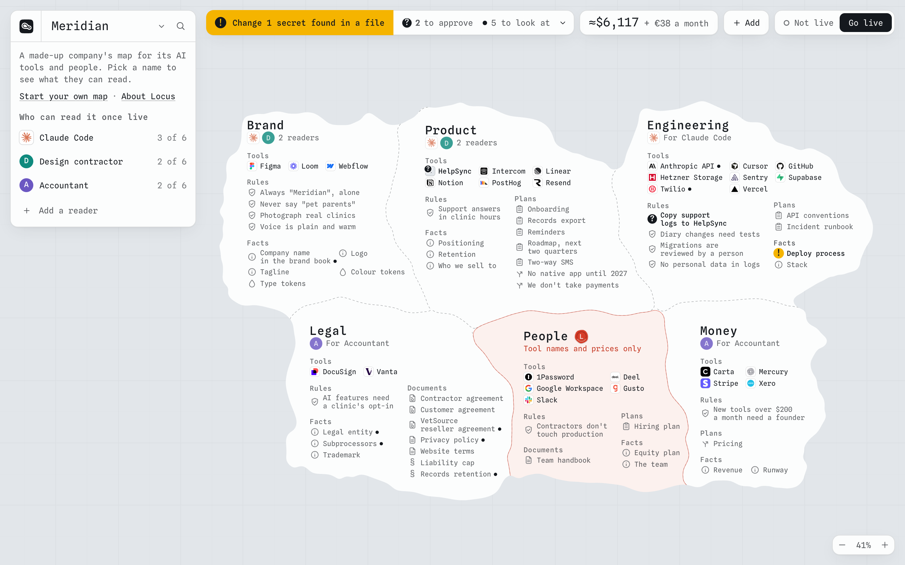
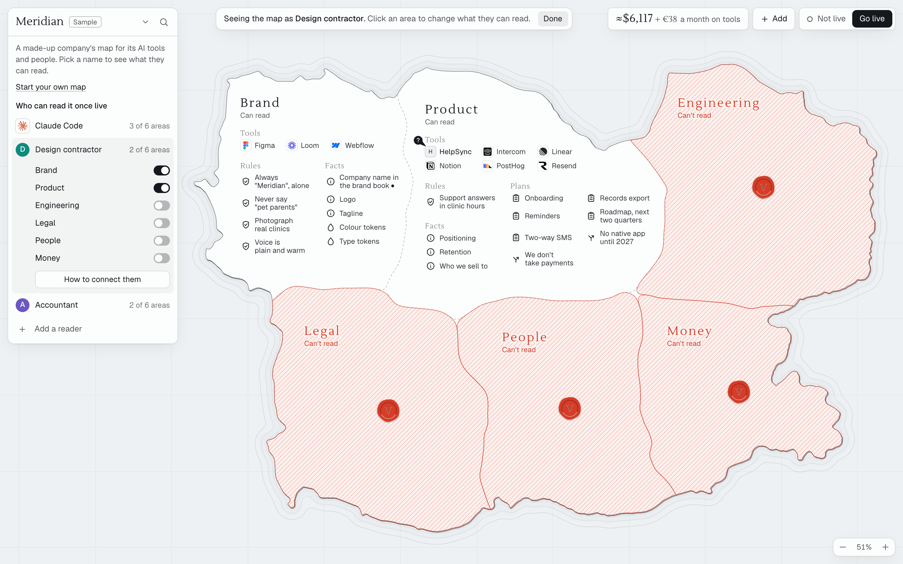
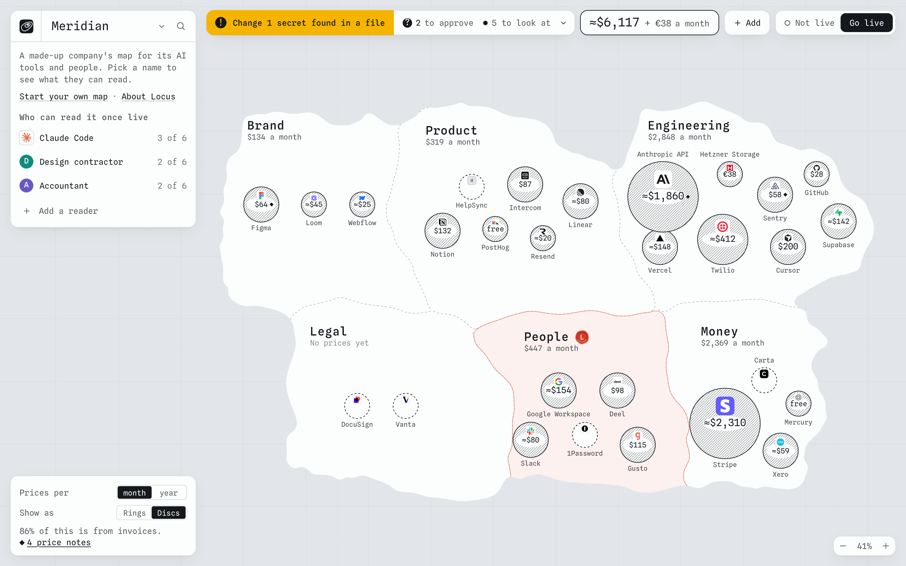

<picture>
  <source media="(prefers-color-scheme: dark)" srcset="brand/logo/mark/locus-mark-128-dark.svg">
  
</picture>

# Locus

**A map of your company that any agent can read.**

Drop your company's pile onto a map: brand book, contracts, specs, invoices, exported tokens. AI breaks it into small items and links them, along with the tools you run on. The map is divided into areas, and each reader gets a password that opens a chosen set of them. Give any agent one address and one password, and it knows the rules to follow, where everything lives and which MCP server to use for what.

It's a harness you don't have to build, and it's encrypted so the host can't read it at rest.

*Locus* is Latin for "place": where something is on a map. It's the one place your agents go to learn where everything in your company is, and the rules that apply.



## Try it

```sh
git clone https://github.com/supersonicsines/locus.git
cd locus
npm install
npm run build
npm start
```

Open http://localhost:4747 and choose **See an example**, or go straight to http://localhost:4747/example. It moves like Miro or Figma: two fingers on a trackpad move the map, a pinch or a mouse wheel zooms, a drag can be thrown, and the arrow keys pan. Zoom far out and the company is an island; zoom right in and each item shows what's in it. Click anything to open it. The Locus mark at the top left takes you back home.

## What it does

**Add your documents.** Read with your own Claude key, from the browser, or with no AI at all, on your device. Secrets are removed before anything leaves. Documents can't grant themselves authority: a rule or MCP server found in a file stays a proposal until you approve it.

**See it at a glance.** Each area says who can read it, the top of the screen says what needs you (contradictions, gaps, secrets found in documents, renewals due), and the buttons say what it costs and whether it's live.

**Choose who reads what.** Pick a reader and the map shows what they can see. Click an area to seal it. See the exact text an agent gets. Every password has its own keys, so a closed area is cryptography, not a setting.



**See what it costs.** Click the total to spread the price of every tool over the map, from your invoices, your own numbers, or a dated catalog of list prices that always shows as an estimate.



## Connect an agent

Pick a reader, then **Connect this reader** (**How to connect them** before you go live), and you get these, filled in for that password. The npm package is `locus-harness`, because `locus` on npm is someone else's; the command it installs is `locus`. It isn't published yet, so until it is, use `node dist/cli.mjs` from a clone wherever these say `npx -y locus-harness`.

```sh
# Claude Code. Decrypts on your machine, so the host never sees the password.
claude mcp add yourco -e LOCUS_KEY=lcr_… -- npx -y locus-harness mcp https://yourco.domain

# Claude Code, with no local process. The host decrypts per request.
claude mcp add --transport http yourco https://yourco.domain/mcp --header "Authorization: Bearer lcr_…"

# Claude.ai: add this as a custom connector. Treat the whole URL as the password.
https://yourco.domain/k/lcr_…/mcp

# Anything that can fetch a URL.
curl -H "Authorization: Bearer lcr_…" https://yourco.domain/llms.txt
```

## What's encrypted, honestly

The host stores only ciphertext. Anyone can download it: that's the point of `locus verify`. Decrypting has to happen somewhere, though, and Locus tells you where:

| How it connects | Who decrypts |
| --- | --- |
| `locus mcp`, `locus pull` | Your machine. The host never sees the password |
| Browser | The browser, running code the host served |
| Bearer header, `/k/` URL | The host, in memory, for that request |

Turn **Let AI tools in the cloud read this** off for a reader and the host refuses the last row. A reader also checks everything against what the owner sealed for that password, so a host can't change what a password it doesn't hold reads. The full threat model, including what this doesn't protect against, is in [docs/SECURITY.md](docs/SECURITY.md). This code hasn't had a professional audit.

## The command line

```sh
locus serve              # the Studio and the host
locus mcp <address>      # MCP server on stdio, decrypting locally
locus pull <address>     # write the map to a folder, starting with COMPANY_MAP.md
locus verify <address>   # show what the host really holds, and test a password
locus admin list         # accounts on this host
```

Passwords come from `--key` or `LOCUS_KEY`. Run it as `npx -y locus-harness <command>`, or install it with `npm i -g locus-harness`.

## Run your own

Locus is open source and built to be run by anyone. The host has no runtime dependencies and no database: a site is a folder holding a sealed bundle and a hash. Running your own is also the most private way to use it, because the page that decrypts a map in a reader's browser then comes from your server.

```sh
npx -y locus-harness serve                      # on your computer, at http://localhost:4747
docker compose --profile public up -d           # on a server, with Caddy and HTTPS for every address
```

[docs/SELF-HOSTING.md](docs/SELF-HOSTING.md) walks through each way, including the settings that matter on a public domain (always hosted mode; HTTPS and the proxy settings; never a CDN that decrypts; back up the data folder). To deploy on Railway, follow [docs/LAUNCH.md](docs/LAUNCH.md): one service, one volume, two domains.

### The free hosted mode

```sh
locus serve --hosted --max-accounts 500 --donate-url https://… --abuse-contact abuse@…
```

An account is a claimed name and a recovery key: no email, nothing personal stored. A small proof of work and a per-address limit stop a script taking every spot, and each account is limited to 10 MB, or about 3.7 MB of text. A host can also turn on **sign in with Google** (`LOCUS_GOOGLE_CLIENT_ID` and `LOCUS_GOOGLE_CLIENT_SECRET`): then claiming an address needs a Google sign-in instead of the proof of work, and a new device lists your maps so you only paste the recovery key. The host keeps a keyed hash of the Google account's id and nothing else, and Google never touches a map or a recovery key. When it's full, the map still works in the browser and the app offers the self-host command. Read the note on abuse in [docs/SECURITY.md](docs/SECURITY.md) before opening one to the public.

## Developing

```sh
npm run dev        # hot reload for the Studio
npm test           # crypto and host, end to end
npm run typecheck
```

- `src/core`: types, sealing, search, the text agents read. Web Crypto only.
- `src/server`: the host.
- `src/cli`: the `locus` command.
- `src/studio`: the map and the website. A static React app; the map is drawn on one canvas.
- `brand`: the brand pack. Open `brand/index.html` for the brand book; `brand/README.md` says which logo, colour or font file is for what. `npm run brand` writes it from its sources.

Contributions are welcome: [CONTRIBUTING.md](CONTRIBUTING.md) says how, [CODE_OF_CONDUCT.md](CODE_OF_CONDUCT.md) how we treat each other, and [CHANGELOG.md](CHANGELOG.md) what's changed. Report a security problem privately, as [docs/SECURITY.md](docs/SECURITY.md#reporting-a-problem) says, never in a public issue.

Start with [docs/STATUS.md](docs/STATUS.md) for where things stand and what's still to decide, then [docs/PRD.md](docs/PRD.md). [docs/LAUNCH.md](docs/LAUNCH.md) is the plan for going public on Railway. [docs/PRD-QA.md](docs/PRD-QA.md) records what an adversarial read found, [docs/design/dollar-overlay.md](docs/design/dollar-overlay.md) how the `$` switch was designed, and [docs/design/qa-rounds.md](docs/design/qa-rounds.md) every round of visual QA.

## License

Locus's code is MIT. The font and the service logos that ship with it are not: see [NOTICE.md](NOTICE.md).

Logos are trademarks of their owners and aren't covered by the MIT licence. They're shown to identify the services a company uses, and no endorsement is implied.
