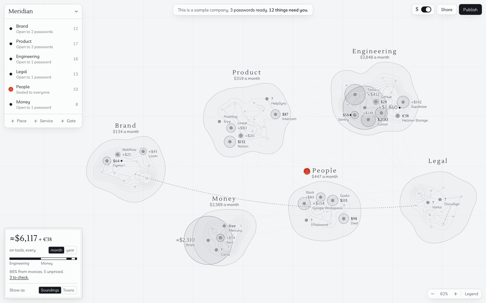
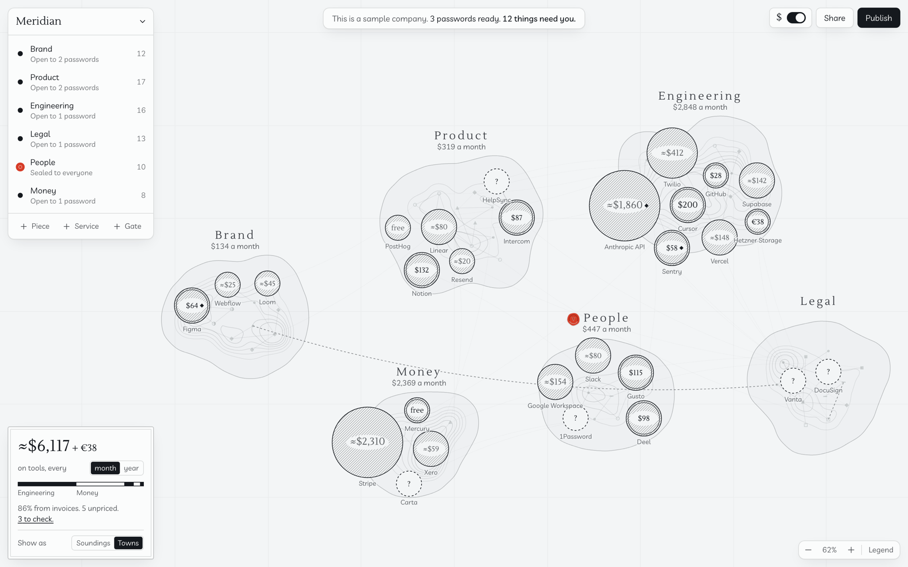

# The `$` switch: two options

Worked out in a three-round debate between two Claude Opus 5.5 instances. One started with three proposals (Price Pins, Spend Relief, Ledger Plate) and the other replied with two of its own. Each then critiqued the other's until these two were locked. Both are built, and the founder picks one.

The debate called them Soundings and Towns, and the code still does. The screen says Rings and Discs, and so does this document.

The options split on one question: **does money annotate the geography, or replace it?**

## The two options

**Rings:** press `$` and every service's price prints onto your chart like depth soundings, and ink pools where the money is.

**Discs:** press `$` and your services swell into engraved towns, so the biggest bills are the biggest places on the map.

The reviewing agent's vote was Rings, as the one to keep open every day. Discs wins the first two seconds and the screenshot.

## Shared by both

- **The switch:** top right, like Figma's Dev Mode. A password without the Money gate never sees it, and prices never reach that client.
- **The total** is on the switch itself, for example `≈$1,240 + €120 a month`. It isn't repeated.
- **A card**, bottom left, with a month/year switch, Rings or Discs, and one quiet sentence: `71% of this is from invoices. 4 price notes`. Each area says its own figure under its name, so the bar of areas by share of spend that once sat here was removed in the Locus pass: it said nothing the map didn't. On a phone it's only the month/year switch and the sentence.
- **Subtotals** under each area's name.
- **Colour:** ink only. Vermilion keeps its one meaning, sealed.
- **Three trust states:** known (invoice or typed), estimate (`≈`; list prices and usage), unknown (`–`). Every figure is in full ink: the `≈` says estimate, and grey as well only made the figures hard to read. `free` is a value, not a state. The source itself goes in the peek.
- **To check** means something you can act on: unknown price (grouped into one entry), invoice more than 20% above list (flat plans or known seat counts only), renewal within 30 days, or a usage jump above 25% (needs two invoices). Marked with a small diamond beside the figure, and the same diamond stands beside `4 price notes`, so one explains the other.
- **One cost per service.** Precedence: you, invoice, list. The latest invoice wins, and annual invoices become monthly.
- **Currencies are never converted.** A map has a main currency. Shares and sizes use the main currency only. Other-currency services get the smallest mark, their own figure, and no share of the main total.
- **Names by priority.** Every figure is always placed. Names are added where they fit: to-check items first, then by cost. A figure or name that would sit on another disc goes above its own. An area with no prices says `No prices yet`. Valid placements persist when zoom settles, and only changed labels crossfade. Hover names anything unnamed.
- **The camera stays where you put it.** If you've panned or zoomed, the toggle leaves it alone, unless no service would be in view at all. If you haven't, it eases just enough to keep every price in frame. (Changed during build: big marks otherwise spilled off screen and hid territory names.)
- **Later:** cheaper-alternative recommendations arrive in the peek, with a mark on the map (below).

## Rings

The debate's version moved nothing. Since Round 3, services spread over their land under both options to make room, so this one no longer keeps every position exactly.

- **Mark:** hairline ring plus a 6% ink wash, so overlaps accumulate like ink on paper. Stacked darkness clamps at about 30%, and figures get a paper halo.
- **Size:** true area, no floor. Radius = 72 × √(cost ÷ max(biggest bill, $500)). $4,000 gives 72, $300 gives 20.
- **Labels:** greedy placement, biggest money first, with hairline leaders as a fallback.
- **Other pieces:** drop to 15%.
- **Transition:** rings and wash ripple out of the symbols, figures print largest-first, about 500 ms. Reversible.
- **Later:** a dagger on the figure.
- **Weakness:** a dense gate can still get busy, and rings answer "where does the money go?" more quietly than Discs.

## Discs: services shoulder aside, land frozen

- **Mark:** a disc with fine engraved hatching, figure knocked out in the centre. Rim by trust: double (known), single (estimate), dashed (unknown, unhatched, smallest class).
- **Size:** five fixed classes, like settlement symbols on an old chart. Fixed classes mean a single large bill doesn't flatten the rest, and symbols don't change when another bill does.

  | Monthly cost | Radius |
  | --- | --- |
  | under $50 | 20 |
  | $50 to $249 | 28 |
  | $250 to $999 | 40 |
  | $1,000 to $4,999 | 56 |
  | $5,000 and up | 72 |

- **Position:** collision physics pushes discs apart, each pulled towards its own saved position, with each disc kept on its own land. The land doesn't move, so it stays recognisable.
- **Zoom:** discs scale with zoom, figures stay a constant screen size, and zoom-out clamps at fit-all while the overlay is on. In year view, a figure that doesn't fit moves beneath its disc.
- **Legend:** five reference symbols, shown only while hovering the prices card.
- **Other pieces:** fade to 15%.
- **Transition:** discs swell and shoulder their neighbours, about 700 ms, one precomputed reversible tween that lands exactly on the saved layout.
- **Later:** a small satellite disc with the cheaper price, so the saving shows as a size difference.
- **Weakness:** motion costs spatial memory while the overlay is on, and it needs excellent engraving to avoid looking like a bubble chart.

## What the build showed

Tested at 5 services and at 60, among 40 to 240 other pieces, at 60 frames a second.

- **At 60 services, Discs is the clearer of the two.** This goes against the debate's prediction. Figures sit inside their discs, so they never collide. In Rings, big rings overlap and a dense gate gets busy, though it stays readable.
- **At a typical 25 services, both read well.** Rings kept your place, and every service's position, exactly, as it was built then.
- **Rings' names sit beside their figures; Discs' sit under their discs.**

## Rejected along the way

- **Price Pins:** pure Airbnb costume, and 60 of them bury the map.
- **Spend Relief (terrain):** gorgeous, but Gaussians sum, so two neighbouring $100 tools read as one $200 peak, and a legend claiming "1 contour = $50" lies. It also can't show what's off.
- **Ledger Plate:** a table in engraver's clothes, which strains "the map is the app". Its two-way hover survives.
- **Literal coins:** mush at small sizes, and coins plus a crypto donation button reads as a token launch.
- **Green ink:** would end vermilion's status as the only colour.
